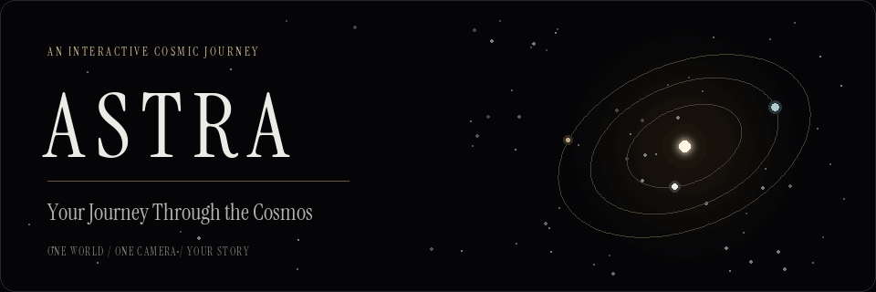

<div align="center">



**A scroll-driven journey from the Sun to a single point of light.**

[Start locally](#start-locally) · [The journey](#the-journey) · [Project map](#project-map) · [Status](#status)

<sub>Original procedural README artwork · [Still version](docs/assets/astra-banner.png) · [Animated SVG](docs/assets/astra-banner.svg)</sub>

</div>

---

ASTRA brings astrology and numerology into one continuous camera flight. Real HTML carries the story over a fixed WebGL canvas: procedural worlds, constellations, typography made from particles, a birth-chart instrument, and a black hole that bends the sky.

The banner above is documentation artwork, not a recording of the application.

## The journey

| Chapter | Experience |
| :--- | :--- |
| 00 · Origin | Enter the cosmos and begin the descent. |
| 01 · Inner worlds | Pass the Sun, Mercury, and Venus. |
| 02 · Earth | Pause beside Earth and its graduated instrument rings. |
| 03 · Outer worlds | Travel past the Moon and the outer planets. |
| 04 · Constellations | Watch the twelve zodiac figures draw and disperse. |
| 05 · Numerology | Nine particle numerals form; one remains. |
| 06 · Birth chart | Enter a birth date to generate a chart and Life Path reading. |
| 07 · Nebula | Fly through glowing gas and absorbing dust. |
| 08 · Singularity | Approach the accretion disk and cross into darkness. |
| 09 · Observatory | Return to a quiet sky and explore four courses. |
| 10 · Consultation | Open a personal reading enquiry. |
| 11 · Return | See the route become a line, then a point. |

## Start locally

Requires **Node.js 20.9 or newer** and npm.

```sh
npm ci
npm run dev -- --port 3002
```

Open **http://127.0.0.1:3002**. For automatic entry after loading, use **http://127.0.0.1:3002/?skip**.

Running `npm run dev` without the port option uses port 3000 when available.

### Environment

Copy `.env.example` to `.env.local` and configure:

```dotenv
NEXT_PUBLIC_SITE_URL=http://localhost:3000
CONSULTATION_WEBHOOK_URL=
```

| Variable | Purpose |
| :--- | :--- |
| `NEXT_PUBLIC_SITE_URL` | Canonical site URL used by metadata, sharing, and the sitemap. Set it to the deployment URL when publishing. |
| `CONSULTATION_WEBHOOK_URL` | Optional destination for consultation enquiries, sent as JSON. When empty, enquiries are written to the server log. |

### Commands

| Command | Purpose |
| :--- | :--- |
| `npm run dev` | Run the local Next.js development server. |
| `npm run typecheck` | Check TypeScript without emitting files. |
| `npm run build` | Create the production build using webpack. |
| `npm run start` | Serve an existing production build. |

## Built with

**Next.js 16 · React 19 · TypeScript 5.9 · Tailwind CSS 4**

**Three.js 0.186 · React Three Fiber 9 · Drei 10 · Postprocessing**

**GSAP 3.15 · ScrollTrigger · Lenis · Zustand 5**

Instrument Serif supplies the display typography and sampled numerals. Geist and Geist Mono carry the text and instrument labels.

## How it works

- **One timeline:** measured DOM chapters write to shared journey state; the scene reads that state each frame.
- **One world:** art-directed coordinates place the planets, constellations, nebula, and black hole along the same route.
- **One camera:** keyframes define position, look direction, framing, field of view, and roll.
- **Procedural visuals:** GLSL surfaces, particle systems, generated noise, and sampled glyphs create the scene without downloaded planet textures or models.
- **Accessible document content:** the copy remains HTML, with reduced-motion handling, a WebGL fallback, keyboard controls, and consultation dialogs.

Birth-date readings use **noon UT** and omit houses and the Ascendant because no birth time or birthplace is collected. Astrology and numerology are presented as interpretive practices for reflection.

## Project map

```text
src/
├── app/                  Pages, global styles, metadata, consultation API
├── assets/               Bundled display font and its license
├── components/
│   ├── cosmic/           Canvas, camera orchestration, scroll, HUD, chapters
│   ├── three/            Procedural scene systems and shared materials
│   ├── sections/         HTML chapters and footer
│   └── ui/               Loader, navigation, chart, forms, dialogs, cursor
├── data/                 World coordinates, constellations, courses, navigation
├── hooks/                Magnetic interactions and cosmic events
├── lib/
│   ├── astro/            Ephemeris, zodiac, reading calculations
│   ├── camera/           Flight keyframes and interpolation
│   └── three/            Glyph sampling, noise textures, shared uniforms
└── shaders/              GLSL for the worlds, particles, sky, and lens
docs/assets/              Animated README banner and its generator
```

### Make it yours

| Change | File |
| :--- | :--- |
| Brand, contact details, and social links | [`src/lib/brand.ts`](src/lib/brand.ts) |
| World positions and dimensions | [`src/data/world.ts`](src/data/world.ts) |
| Camera flight | [`src/lib/camera/keyframes.ts`](src/lib/camera/keyframes.ts) |
| Chapters and journey lengths | [`src/lib/journey.ts`](src/lib/journey.ts) |
| Particle counts and rendering tiers | [`src/lib/quality.ts`](src/lib/quality.ts) |
| Courses | [`src/data/courses.ts`](src/data/courses.ts) |
| Colors, layout, and typography | [`src/app/globals.css`](src/app/globals.css) |

## Status

The latest application checks passed TypeScript and the production build; the local server returned all twelve chapters. Full browser/GPU review is still pending. Exact compliance with the original brief is not certified because parts of its supplied source are missing. See [`TODO.md`](TODO.md) for the audit and remaining verification.

## README artwork

The looping GIF, still PNG, and animated SVG are local files. They require no external image service. The SVG respects `prefers-reduced-motion`; a still version is also linked above.

To regenerate the GIF and PNG, install Python with Pillow and run:

```sh
python -m pip install Pillow
python docs/assets/generate_banner.py
```

The generator uses the bundled Instrument Serif font and a seeded starfield. The animation illustrates ASTRA's visual theme without changing the application.

---

<div align="center"><sub>Look up. Look within.<br/>And it all started with you.</sub></div>
